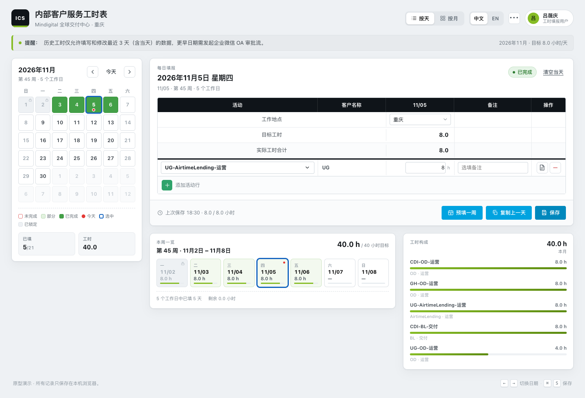

# Mindigital 服务工时表 · ICS 工时填报

Mindigital GDC 内部服务工时系统（原 Internal Client Service Timesheet）的完整可交互复刻：月历状态 + 每日工时明细 + Prefill / Copy / Save。
独立 Axhub Make 项目，push `main` 自动构建并发布到 GitHub Pages。界面默认英文，右上角可一键切换中英文。

**演示站：** https://phosphorescent2018.github.io/Deloitte-ICS-Timesheet/



## 功能

### 月历

- 周日起排的 6×7 月历，工作日与周末区分，跨月日期淡显。
- 状态色：未填写（浅红底红框）、部分填写（浅黄）、已完成（深绿）、今天（日号下方红色小圆点）、选中（蓝色描边）、已锁定（灰底带锁）。可填写窗口内（今天及前 2 天）未填写的日子显示为红色，提醒补填。
- 月份切换、`Today` 快速回到本周。
- **2026 年法定节假日**：按国务院办公厅 2026 年放假安排标注，节假日显示「休」、调休上班日显示「班」；工作日数量、目标工时与红色未填写提示都按实际工作日计算（跳过节假日、包含调休上班日）。
- **可编辑范围**：只允许填写/修改今天及前 2 天（含当天共 3 天）的工时；更早日期在日历中置灰并带锁图标，点击会弹窗提示「企业微信 OA 审批流」。本月内的未来日期可以正常填写，但**下个月及以后**的日期一律锁定，点击提示「不能填写下月工时」。

### 每日填报

- `Work Location` 下拉：重庆 / 北京 / 新加坡 / 远程。
- `Target Hours` 固定为 8.0，仅用于状态判定（达到 8 小时为「已完成」），不再单独展示；当天实际工时合计上限为 24 小时。
- `工作项` 可搜索选择器：选项为「业务线-产品-业务阶段」组合，业务线 UG / CDI / GH，产品 OD / AirtimeLending / BL，阶段 运营 / 交付，共 18 个组合（如 `UG-OD-运营`、`CDI-AirtimeLending-交付`），按业务线分组、支持搜索。
- 多行工作项：工时、Remark、添加 / 删除行；Operation 列只保留删除按钮；工作项代码右侧的复制图标可一键复制当前工作项名称。
- 校验：当天工时合计不得超过 24 小时、不允许负数；填了工时必须选工作项代码。允许保存空内容（保存后当日会以红色提醒未填写）。
- `Save` 保存到当前会话（刷新后回到默认演示数据）；保存后日历与周/月统计立即更新。

### 三个核心动作

| 按钮 | 行为 |
| --- | --- |
| **Prefill one week** | 用当前表单（若为空则回退到最近一条已保存记录）预填本周一至周五；已有记录的日期自动跳过，工时按目标值等比缩放并抹平取整误差。 |
| **Copy last day** | 向前回溯最多 90 天，复制最近一条有工时的记录到当前日期，标记为「未保存」，提示 review & save。 |
| **Save** | 保存当天记录并刷新日历状态；`⌘/Ctrl + S` 同样生效。 |

### 后台配置

- 顶栏右上角齿轮图标进入（悬停提示「后台配置」）：维护 **业务线 / 产品 / 业务阶段 / 工作地点** 四类基础数据，支持添加、删除，至少保留一项；业务线/产品/业务阶段添加时需二次确认。
- 工作地点只需填写一个名称，填什么显示什么；不允许特殊字符（只允许中英文、数字和空格），新增/删除后填报页的「工作地点」下拉实时同步；组合数（业务线 × 产品 × 阶段）不含工作地点。改动仅当前会话生效，刷新后恢复默认配置。
- **用户管理**：新增 / 编辑 / 删除用户，字段含姓名、工号、部门、角色与启用状态。角色只有 **超级管理员 / 填报用户** 两种；只有超级管理员能看到并点击顶栏后台按钮，填报用户完全不显示该入口。至少保留一名超级管理员（删除或降级最后一名都会被阻止）。改动仅当前会话生效，刷新后恢复默认用户。登录页为演示，企业微信登录或邮箱密码登录均直接进入，不做账号校验。
- **导出当月数据（Excel）**：按 15 列导出当月全部填报明细（CSV，UTF-8 BOM，Excel 可直接打开）——序号、员工姓名、员工工号、部门、业务线、产品、业务阶段、日期、星期、工作地点、状态、工作项代码、本行工时、备注、保存时间。
- **匿名反馈**：登录页底部提供「匿名反馈」入口，不需要登录；后台「匿名反馈」列表可查看内容、提交时间、待处理/已处理状态，并可切换状态或删除。原型只存在当前会话内存，不含提交人信息。

### 其他

- **Day / Month 双视图**：月视图按天列出地点、工作项、工时、状态，点击任意行回到当日编辑。
- 切换日期 / 月份时如有未保存改动，弹窗提供「保存并切换 / 放弃修改」两个选择；点弹窗外、关闭按钮或 Esc 等同继续编辑。
- 刷新即重置：填报、用户、基础配置与匿名反馈的改动都只在当前会话有效，刷新页面会恢复到默认演示数据，因此不再提供「Reset demo data」按钮。
- 键盘：`←` `→` 切换日期，`⌘/Ctrl + S` 保存。
- **退出登录二次确认**：点击顶栏用户胶囊后，控件原地变为红色提示「再次点击退出账户」；3.2 秒内再点一次才退出，超时或点击别处自动还原；有未保存修改时提示会说明修改将丢失。
- **中英文切换**：每次进入默认英文，右上角「中文 / EN」可切换（仅当次会话，刷新后回到英文）。

## 技术栈

React 18 + TypeScript + Vite 5，无 UI 组件库，纯手写 CSS（企业灰 + 品牌绿 `#86BC25`），产物为纯静态站点。

## 本地运行

```bash
npm install
npm run dev        # http://localhost:5178
npm run build      # 产物在 dist/
npm run typecheck  # TypeScript 全量检查
```

## 目录结构

```
.
├── index.html                       # 静态站点入口
├── src/
│   ├── main.tsx                     # React 挂载
│   └── prototypes/timesheet/
│       ├── index.tsx                # Axhub Make 原型入口（default export）
│       ├── TimesheetApp.tsx         # 页面状态与业务流程
│       ├── LoginPage.tsx            # 登录页（演示，点击直接进入）
│       ├── AdminPage.tsx            # 后台配置（基础数据维护 + 数据导出）
│       ├── Calendar.tsx             # 月历
│       ├── DayEditor.tsx            # 每日工时明细表
│       ├── ActivityPicker.tsx       # 工作项代码搜索选择器
│       ├── MonthView.tsx            # 月视图
│       ├── ui.tsx                   # 图标 / Toast / Modal / 状态胶囊
│       ├── timesheet.css            # 全部样式
│       └── lib/
│           ├── date.ts              # 日期与周计算
│           ├── config.ts            # 后台配置（业务线/产品/阶段）与组合生成
│           ├── users.ts             # 用户与角色（默认数据，会话内）
│           ├── holidays.ts          # 2026 年法定节假日与调休上班日
│           ├── catalog.ts           # 办公地点默认值
│           ├── model.ts             # 数据模型、校验、统计
│           └── storage.ts           # 演示数据生成（刷新即重置）
├── .axhub/make/                     # Axhub Make 项目身份与资源清单
├── .github/workflows/deploy-pages.yml
├── docs/preview.png
├── docs/TECHNICAL.md                 # 原型技术文档
├── docs/PRODUCTION-DESIGN.md         # 生产化设计与实施指南
```

## 数据与演示数据

- **刷新即重置**：每次打开或刷新页面都会重新生成「本周已填」的演示数据（周一至周五，每天 8h），不读取本地历史。
- 填报、用户、基础配置的改动都只在当前会话有效；刷新后填报数据、用户列表与业务线/产品/阶段都会回到默认值。
- 数据导出见「后台配置 → 数据导出」。

## Axhub Make 独立项目

`.axhub/make/` 保存项目身份（`client.json`）、资源清单（`project.json`）与入口缓存（`entries.json`）。
原型入口为 `src/prototypes/timesheet/index.tsx`，默认导出的组件即整页应用；项目 id 为 `ics-timesheet`，与其它原型项目（如 `risk-control-platform`）完全独立，不共享项目 id 与目录。

## 部署

推送到 `main` 后，GitHub Actions（`.github/workflows/deploy-pages.yml`）执行 `npm ci` + `npm run build`，将 `dist/` 发布到 GitHub Pages。

## 技术文档

- 原型架构、数据模型、业务规则、Axhub Make 集成与部署细节：见 [`docs/TECHNICAL.md`](docs/TECHNICAL.md)
- 后续真实写程序 / 上线的生产化设计（数据库、API、登录、审批、部署）：见 [`docs/PRODUCTION-DESIGN.md`](docs/PRODUCTION-DESIGN.md)

## 说明

界面默认英文（右上角可切中文），代码注释与文档为中文。
本项目为原型演示，不含真实后端、审批流与权限体系，所有数据仅存在当前页面内存，刷新即重置。
